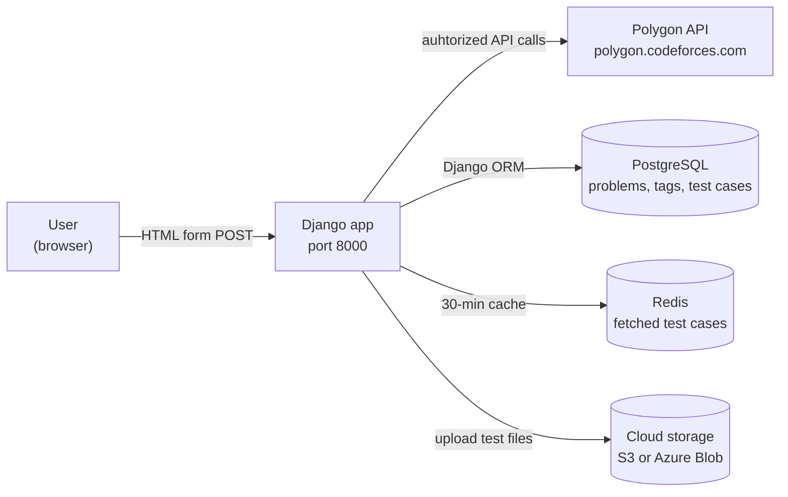
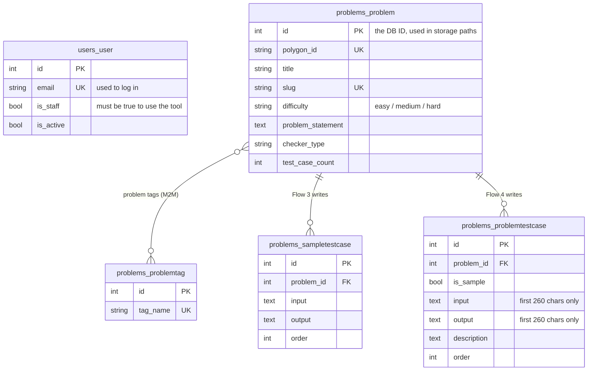
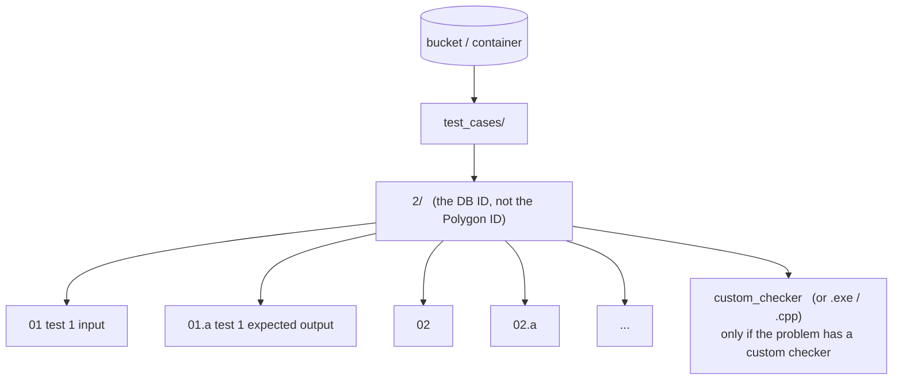
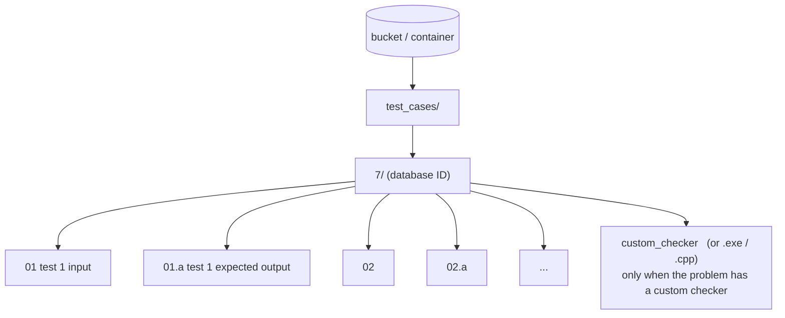

# Polygon Migration Tool — Functionality Documentation

## Overview

## 2.1 User Flows

This section follows a user through the five things they can do in the tool, from the button clicked down to the database rows and files that change.

> **How to read each flow**
> Every flow has the same six parts: *what the user does,  what the browser sends,  what the backend does,  which outside services are called,  what gets stored, what the user sees*. 

---

### Before you start

#### At a glance

NOTE :  The words are entirely mine(pritish) but graphs and tables are designed with the help of AI.

---

The tool is one Django app. Users open it in a browser, and the application communicates with  four other components:

| System | What the tool uses it for | Where the code is |
|---|---|---|
| **Polygon** | The source of truth. All problems are added here, and we read statements, input, output, tests, checkers and solutions from it. | `problems/polygon_api.py`-> class `PolygonAPI` |
| **PostgreSQL** | Our own copy of each problem (statement, difficulty, tags, sample tests, test previews). | `problems/models.py`, `users/models.py` |
| **Redis** | A short-lived cache( 30 minutes ),  so we don't download every test from Polygon again on each click. | `PolygonAPI.store_test_cases_in_redis()` / `get_test_cases_from_redis()` |
| **Cloud storage** | Holds the real test input/output files that the online judge runs against. | `problems/storage/` (`factory.py`, `s3.py`, `azure_blob.py`, `paths.py`) |

#### NOTE :  The modified code has a factory through which we can add any cloud proider for storage like AWS S3, Azure, etc.

---

#### Important terms

| Term | What it means here |
|---|---|
| **Polygon ID** | Polygon's numeric ID for a problem, e.g. `617220`. The user types this in. It is saved in `Problem.polygon_id`. |
| **DB ID** | Our database primary key, `Problem.id` (e.g. `2`). Cloud storage folders are named after this ID, **not** the Polygon ID. All test cases on cloud are added inside this Id as a folder name. |
| **Server-rendered page** | There is no JavaScript API. Every button is a normal `<form method="post">`, and the server replies with the whole page re-rendered from `problems/templates/problems/index.html`. |
| **Authorized Polygon request** | Every Polygon call is a `POST` to `https://polygon.codeforces.com/api/<method>` with `apiKey`, `time` and `apiSig` (a SHA-512 hash of the parameters plus the secret). This is built in `PolygonAPI._generate_api_sig()` and sent by `_make_request()`. The credentials are fetched from polygon's website as **API_KEY** and **API_SECRET**|
| **`atomic trnasactions`** | All database work for one click runs in a single transaction. If anything fails, every database change from that click is undone/ rollbacked. |

#### The database tables involved

---

### 1. User login

> **In one line:** the user enters an email and password, Django server checks them against `users_user`, and only staff accounts get in.

**What the user clicks or submits**:
The user goes to `/users/login/`. 
They also land there automatically if they open `/` without being logged in. They fill in **Email** and **Password** on the "Staff Login" card and click **Login**.

*Template:* `users/templates/users/login.html`

**Data sent from the frontend to the backend**:
`POST /users/login/` (form-encoded)

| Field | Example |
|---|---|
| `email` | `user@email.com` | 
| `password` | `••••••` |

**Backend flow**:
*Code:* `users/views.py-> login_view()`, `users/backends.py-> EmailBackend.authenticate()`

1. **Logs out anyone already logged in.**
2. Reads `email` and `password` from the form.
3. Calls `authenticate()` function. Starting with our **`EmailBackend`**, which:
   - finds the user by email: `User.objects.get(email=email)`;
   - checks the password hash with `user.check_password()`;
   - checks the account is active (`user_can_authenticate()`-> `is_active`).
4. Decides the outcome:
   - No match-> error message *"Invalid email or password."*
   - Match but `is_staff` is false-> error message *"You do not have staff access."*
   - Match and staff-> `login(request, user)`, then redirect to `problems:index` (`/`).

**External APIs called**:
None. Login is handled entirely by our server and the database.

**Database / storage reads and writes**:

| Where | Read / write | What |
|---|---|---|
| `users_user` | Read | One row, looked up by `email` |
| `users_user` | Write | `last_login` updated on success |
| `django_session` | Write | New session row (Django's default database-backed sessions) |
| Browser cookie | Write | `sessionid`, valid for 1 day (`SESSION_COOKIE_AGE = 86400`) |

**What the user sees when it completes**:
- **Success:** the "Hatsu: Problem Migrator" page, with *"Welcome, First Last"* and a **Logout** button in the top bar.
- **Failure:** the login form again, with a red alert showing the error message.

---

### 2. Fetching a problem from Polygon

> **In one line:** the user enters a Polygon ID, the server downloads the problem and all its tests from Polygon, caches the tests in Redis for 30 minutes, and shows everything on the page. **Nothing is saved to the database.**

**What the user clicks or submits**:
The user types a Polygon problem ID (e.g. `617220`) into **"Enter Polygon Problem ID"** and clicks **Fetch Problem**.

**Data sent from the frontend to the backend**:
`POST /` (form-encoded)

| Field | Example |
|---|---|
| `csrfmiddlewaretoken` | *auto* |
| `problem_id` | `617220` |

**What the backend does, in order**:
*Code:* `problems/views.py -> index()`, helpers in `problems/polygon_api.py`

1. **Prepares the tag picker.** Loads every `ProblemTag` and passes it to the page as JSON (`all_tags_json`).
2. **Checks if we've seen this problem before** with `Problem.objects.filter(polygon_id=...)`. If yes, it:
   - pre-fills difficulty and tags from the database; 
   - fetches the **main solution** from Polygon: `problem.updateWorkingCopy`-> `problem.solutions`-> picks the one tagged `MA` (or the first one)-> `problem.viewSolution`.
3. **Starts a database transaction** (`transaction.atomic()`).
4. **Gets basic info:** `get_problem_info()`-> Polygon `problem.info` (name, time limit, memory limit).
5. **Pulls the sections out of the HTML:** `parse_problem_html()` uses lxml to grab the title, legend (statement), input format, output format and notes.
6. **Downloads every test case:** `get_all_test_cases()` calls `problem.tests` to list them, then `problem.testInput` and `problem.testAnswer` **for each test**.
7. **Caches the tests** with `store_test_cases_in_redis()`, 
8. **Prepares the rest of the page:** Trimmed 50-character previews of each test, a slug from the title, and the checker type from `problem.checker`. The test count comes from another `problem.tests` call.
9. Renders `index.html` with all of this in `context['fetched_problem']`.

**Database / storage reads and writes**:

| Where | Read / write | What |
|---|---|---|
| PostgreSQL | **Read only** | All tags; the `Problem` row by `polygon_id` (if any) |
| Redis | Write | Test cases, under the keys shown below, expiring after 30 minutes |

**What the user sees when it completes**:
- **Fetched Problem: *Title* (Polygon ID: 617220)** with:
- **Database Problem ID** and **Algopath Link**, or *"Please migrate to database first."* for a new problem;
- slug, a **Difficulty** dropdown (required later), a **Tags** picker, time and memory limits, checker type and test count;
- the statement, input format, output format and notes;
- an **All Test Cases** table with *View Full* pop-ups;
- the **Main Correct Solution** (only for problems already in the database);
- the action buttons. Two of them stay disabled until the problem is saved (see the state diagram above).

---

### 3. Migrating a problem to the database

> **In one line:** the user picks a difficulty and tags, and the server creates or updates the `Problem` row, replaces its tags, and saves its sample tests. Test data comes from the Redis cache, so it's fast.

**What the user clicks or submits**:
After a fetch, the user:
1. picks a **Difficulty** (Easy / Medium / Hard). This is required, and the browser shows an alert if it's missing;
2. optionally searches for and ticks **Tags**. Typing a new name offers *Add "name"*;
3. clicks **Create/Update problem in Database**.

Before submitting, the script calls `updateHiddenInputs()`, which turns each selected tag into a hidden `tags` field, and shows *"Migrating to database..."*.

**Data sent from the frontend to the backend**:

| Field | Example | Notes |
|---|---|---|
| `problem_id` | `617220` | |
| `migrate_to_db` | `1` | Tells the view to run this flow |
| `difficulty` | `easy` | `easy`, `medium` or `hard` |
| `tags` | `math` | **Repeated** once per tag; read with `request.POST.getlist('tags')` |

**Backend flow**:
*Code:* `problems/views.py-> index()`, the `if migrate_to_db:` block

1. **Checks difficulty.** If it's empty, it raises an error and rolls back.
2. **Creates or updates the problem.** It looks up `Problem` by `polygon_id`:
3. **Replaces the tags.** It removes all current tags (`extra_tags.clear()`). Then, for each submitted name, it finds the tag or creates it (`ProblemTag.objects.get_or_create`) and attaches it to the problem.
4. **Saves sample tests.** It takes the tests marked as samples and lines them up **by position** with the existing `SampleTestCase` rows: it updates the ones that exist and creates the rest. Trailing whitespace is trimmed, and tests with empty input or output are skipped.
5. **Reloads the problem** for display and fetches the main solution from Polygon.
6. **Commits** the transaction and renders the page.

**External APIs called**:
The shared-pipeline Polygon calls (`problem.info`, `problem.packages`, `problem.package`, `problem.checker`, `problem.tests`), plus `problem.solutions` and `problem.viewSolution`. 
The per-test downloads only happen if the Redis cache has expired.

**Database / storage reads and writes**:

| Table | Change |
|---|---|
| `problems_problem` | 1 INSERT (new) or UPDATE (existing) |
| `problems_problem_extra_tags` | All links for this problem deleted, then re-added |
| `problems_problemtag` | INSERT for any tag name that didn't exist yet |
| `problems_sampletestcase` | UPDATE or INSERT, matched by position |
| Redis | Read (written again only on a cache miss) |

**What the user sees when it completes**:
A  **"Database Operation"** alert, e.g. *"Problem 'Sum of Two Numbers' updated in database successfully."* The page shows the **Database Problem ID** and **Algopath Link** (`https://www.algopath.ai/problems/<slug>`), the main solution appears, and the upload and test-case buttons are enabled.

> **ISSUES**
> - `slug` must be unique. Two Polygon problems with the same title clash, and the whole save is rolled back.
> - Old sample rows other than the new count are **not deleted**.

---

### 4. Migrating test cases to the database

> **In one line:** the server saves a **preview** (first 260 characters) and the description of every test into `ProblemTestCase`. The real test files go to cloud storage.

**What the user clicks or submits**:
- The user clicks **Migrate Test Description to Database**, below the test case table. The button is disabled until the problem has been saved. 
- The UI shows *"Migrating test cases to database..."*.

**Data sent from the frontend to the backend**:
`POST /` (form-encoded)

| Field | Example |
|---|---|
| `problem_id` | `617220` |
| `migrate_test_cases_to_db` | `1` |

Difficulty and tags are not sent. The page reloads them from the database for display.

**Backend flow**:
*Code:* `problems/views.py-> index()`, the `if migrate_test_cases_to_db:` block

1. **Runs the shared fetch pipeline**, with test cases from Redis.
2. **Ensure the problem is in the database.** If not, it raises *"Please migrate the problem to the database first."* and rolls back.
3. **Gets the test cases** from Redis, or re-downloads them from Polygon if the cache expired.
4. **Loads the existing `ProblemTestCase` rows**, ordered by `order`.
6. Sets the success message and renders the page.

**External APIs called**:
Only the shared-pipeline Polygon calls. The per-test downloads are skipped while the Redis cache is warm (the server log shows *"Retrieved 1 test cases from Redis"*).

**Database / storage reads and writes**:

| Where | Read / write | What |
|---|---|---|
| `problems_problem` | Read | Find the problem by `polygon_id` |
| `problems_problemtestcase` | Read + write | UPDATE or INSERT, matched by position; `created_at`/`updated_at` set automatically |
| Redis | Read | Cached tests (written again only on a miss) |

**What the user sees when it completes**:
A green **"Success"** alert: *"Test cases description migrated to database Successfully."*

---

### 5. Uploading test cases to cloud storage

> **In one line:** the backend uploads every test's input and expected output as  files under `test_cases/<DB ID>/` in cloud storage and uploads a compiled custom checker if the problem has one.

**What the user clicks or submits**:
The user clicks **Upload Test Cases to Cloud Storage**. The button is disabled until the problem is in the database. The UI shows *"Uploading to cloud storage..."*.

**Data sent from the frontend to the backend**:
`POST /` (form-encoded)

| Field | Example |
|---|---|
| `problem_id` | `617220` |
| `migrate_to_azure` | `1` (add a folder in S3 with name as `1`) |

**Backend flow**:
*Code:* `problems/views.py-> index()`, the `if migrate_to_azure:` block, then `PolygonAPI.migrate_to_azure_blob()` and `upload_custom_checker_to_azure()` in `polygon_api.py`

1. **Requires the problem to be in the database.** Its **DB ID** names the storage folder. If it's missing, the page returns at once with *"Problem with Polygon ID … has not been migrated to the database yet…"*.
2. **Clears the judge's old cache.** `delete_problem_test_case_cache(db_id)` deletes Redis keys matching `oj_dev_with_redis_storage_test_cases_<db_id>*`, so the online judge doesn't keep serving old tests.
3. **Checks for a custom checker** with `get_custom_checker_info()`-> `problem.checker`.
4. **Uploads the tests** (`migrate_to_azure_blob()`):
   - gets the tests from Redis, or from Polygon on a miss;
   - picks the storage provider with `get_storage_backend()`, based on `STORAGE_PROVIDER` in `.env`:
   - for each test (numbered 1, 2, 3… by **position in the list**, not Polygon's indexing on test cases), uploads two files, skipping tests with empty input or output;
   - **only after every upload has succeeded**, deletes any other files in the folder (`delete_prefix(..., keep=uploaded_keys)`). If an upload fails part-way, the previous set of tests is never lost.
5. **Handles a custom checker**, if there is one (`upload_custom_checker_to_azure()`)
6. Sets the success message, then **runs the shared fetch pipeline** to redraw the page.

**External APIs called**:

| Service | Calls |
|---|---|
| Polygon | `problem.checker` (several times), `problem.viewFile` (custom checker only), plus the shared-pipeline calls |
| AWS S3 (`STORAGE_PROVIDER=s3`) | `PutObject` per file, then `ListObjectsV2` + `DeleteObjects` for leftovers |
| Azure Blob (`STORAGE_PROVIDER=azure`) | Azure AD sign-in, `upload_blob(overwrite=True)`, `list_blobs`, `delete_blob` |

**Database / storage reads and writes**:

| Where | Read / write | What |
|---|---|---|
| PostgreSQL | Read only | `Problem` row, to get the DB ID |
| Redis | Read | `polygon_migration_test_cases_<polygon_id>_*` |
| Cloud storage | Write + delete | Files under `test_cases/<db_id>/` (layout below) |

What the bucket looks like afterwards (naming rules are in `problems/storage/paths.py`):

**What the user sees when it completes**:
A green **"Success"** alert: *"Test cases uploaded to cloud storage successfully."* If a custom checker was found, the alert also says it was compiled and uploaded. On failure, the user sees a red **"Error"** alert with the reason.

---
## 2.2 External Integrations

### Polygon API

Everything the server knows about a problem comes from Polygon. 

**There is only one URL.** Every call is a `POST` to
`https://polygon.codeforces.com/api/<method>` (base URL at L26). There are no
`GET`s, and the "method" is part of the path, e.g. `.../api/problem.info`. So a
Polygon call is: pick a method name, build a dict of parameters, POST it.

#### How requests are authenticated

We need two values, both generated on Polygon's own site (log in to
<https://polygon.codeforces.com/> -> Settings -> API -> generate a new API key):

| Value | Env variable | What it is |
|---|---|---|
| API key | `POLYGON_API_KEY` | public identifier, sent with every request |
| API secret | `POLYGON_API_SECRET` | private, **never sent** — only used to compute a hash |

Both are read from `.env` in `settings.py`

The signing happens in `_generate_api_sig()` (L35–67). Step by step:

1. Add `apiKey` and `time` (the current unix timestamp, in seconds) to the
   parameter dict.
2. Sort all parameters lexicographically — `sorted(params.items())`. The order
   matters: Polygon re-computes the same hash on its side and will only match if
   the ordering is identical.
3. URL-encode them into a query string — `urlencode(sorted_params)`.
4. Generate a fresh random 6-character prefix (`[a-z0-9]`) for this one request.
5. Build the string to hash:
   `"<rand>/<method>?<params>#<secret>"`
6. SHA-512 it, hex-encode it, and glue the random prefix back on the front:
   `apiSig = <rand> + <sha512 hex>`

The POST body then carries the normal parameters **plus** `apiKey`, `time` and
`apiSig` (L90–93).

#### Endpoints used

### Problem metadata and statement

| Method             | Purpose                                             | Response |
| ------------------ | --------------------------------------------------- | -------- |
| `problem.info`     | Fetch problem details and limits                    | JSON     |
| `problem.packages` | List packages; selects the latest standard revision | JSON     |
| `problem.package`  | Download the package ZIP containing `problem.html`  | ZIP      |

The statement is extracted from `problem.html`, not a separate API.

### Test cases

| Method               | Purpose                         | Response   |
| -------------------- | ------------------------------- | ---------- |
| `problem.tests`      | List tests and identify samples | JSON       |
| `problem.testInput`  | Fetch test input                | Plain text |
| `problem.testAnswer` | Fetch expected output           | Plain text |

### Checker

| Method             | Purpose                     | Response   |
| ------------------ | --------------------------- | ---------- |
| `problem.checker`  | Identify the checker type   | JSON       |
| `problem.viewFile` | Fetch custom checker source | Plain text |

### Main solution

| Method                      | Purpose                                             | Response   |
| --------------------------- | --------------------------------------------------- | ---------- |
| `problem.updateWorkingCopy` | Refresh the working copy                            | JSON       |
| `problem.solutions`         | List solutions; selects `MA` or the first available | JSON       |
| `problem.viewSolution`      | Fetch solution source code                          | Plain text |

### Cloud storage

Everything about storage lives in `PolygonMigration/problems/storage/`, which is
a small package of four files:

These chnages exit in main branch and are edited by me.
| File | What it is |
|---|---|
| `base.py` | The interface (`StorageBackend`) every provider must implement, plus `StorageError` |
| `paths.py` | The only place that decides what files are **named** |
| `factory.py` | Picks and builds the right provider from `.env` |
| `s3.py`, `azure_blob.py` | The two implementations that exist today |

#### How files are named and organized

What a bucket or container looks like after a migration:

